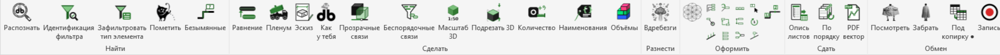

<div align="center">


# XYZ — плагин pyRevit для проектировщиков ОВиК

**Русский** · [English](README_en.md)

[](https://github.com/Budzhak/XYZ/releases)
[](LICENSE)
[](#совместимость)
[](#совместимость)
[](https://t.me/xyz_for_revit)

Чтобы рутина в Revit не омрачала ваше настроение, используйте XYZ.

Марки, взрыв-схемы, пленумы, эскизы по ЕСКД, количества и наименования, ведомости, выпуск листов в PDF. Интерфейс на русском и английском.

</div>



> **EN:** pyRevit extension with MEP tools for Revit (tags, schematics, plenum families, ESKD sketches, schedules, sheet export). Russian and English UI. → [English version](README_en.md)

## Содержание

- [Возможности](#возможности)
- [Совместимость](#совместимость)
- [Установка](#установка)
- [Обновление](#обновление)
- [Кнопки](#кнопки)
- [Общие правила](#общие-правила)
- [Что нового](#что-нового)
- [Если что-то не работает](#если-что-то-не-работает)
- [Лицензия](#лицензия)
- [Обратная связь](#обратная-связь)

## Возможности

Своя вкладка **XYZ** на ленте Revit, шесть панелей:

| Панель | Для чего |
|---|---|
| **Найти** | поиск и выделение: что выделено, чей фильтр, участки без марок |
| **Сделать** | модель: выравнивание трасс, пленумы, эскизы, связи, количества, наименования, объёмы |
| **Разнести** | взрыв-схемы по соединениям |
| **Оформить** | марки и выноски, нумерация, участки фреона |
| **Сдать** | выпуск: опись и нумерация листов, векторный PDF |
| **Обмен** | спецификации ⇄ Excel, оформление ведомостей, запись экрана |

Подсказка к каждой кнопке — при наведении мыши, подробная инструкция — по ссылке в таблице [Кнопки](#кнопки).

## Совместимость

| | Проверено |
|---|---|
| Revit | **2025.4** |
| pyRevit | **6.1.0**, **7.0.0** (7.0.0.26278) |
| Язык интерфейса | русский, английский (по языку pyRevit) |
| Шаблоны | ADSK, свои параметры `db_*` |

> [!IMPORTANT]
> На других версиях Revit и pyRevit плагин не проверялся.

> [!WARNING]
> Плагин писался под конкретные проекты и шаблоны (ADSK, свои параметры `db_*`). Перед массовыми изменениями — пробный запуск и сохранение модели.

## Установка

### 1. pyRevit 6.1.0 или 7.0.0

Закройте Revit, скачайте и запустите установщик (pyRevit 7 — на [странице релизов pyRevit](https://github.com/pyrevitlabs/pyRevit/releases)):
- [pyRevit_6.1.0.26047_signed.exe](https://github.com/pyrevitlabs/pyRevit/releases/download/v6.1.0.26047%2B2255/pyRevit_6.1.0.26047_signed.exe) — обычная установка (для своего пользователя);
- все файлы версии — на [странице релиза 6.1.0](https://github.com/pyrevitlabs/pyRevit/releases/tag/v6.1.0.26047%2B2255).

После установки запустите Revit — на ленте появится вкладка **pyRevit**.

### 2. XYZ — по ссылке Git

1. Закройте Revit.
2. Нажмите **Win + R**, введите `cmd`, Enter.
3. Выполните команду:
   ```
   pyrevit extend ui XYZ https://github.com/Budzhak/XYZ.git
   ```
4. Запустите Revit — появится вкладка **XYZ**.

> [!NOTE]
> В списке расширений pyRevit (pyRevit → **Расширения** / Extensions) XYZ появится с выходом **pyRevit 7.1** — тогда плагин можно будет поставить оттуда одной кнопкой «Установить расширение». Пока — по ссылке Git, как выше.

> [!NOTE]
> Если раньше ставили XYZ вручную, сначала закройте Revit и удалите старую папку `%APPDATA%\pyRevit\Extensions\XYZ.extension`.

**Запасной способ — вручную:** скачайте архив [релиза v1.0](https://github.com/Budzhak/XYZ/releases/tag/v1.0) или вверху этой страницы **Code → Download ZIP**, распакуйте в `%APPDATA%\pyRevit\Extensions\`, переименуйте папку (`XYZ-main` или `XYZ-1.0`) в `XYZ.extension`, затем pyRevit → **Reload**.

### 3. Место вкладки

Вкладка «XYZ» появляется в конце ленты. Чтобы она стояла сразу после «Вставить», в файле `%APPDATA%\pyRevit\xyz_settings.json` поставьте `"tab_after_insert": true` и сделайте Reload.

### 4. Язык названий

Названия и подсказки кнопок есть на русском и английском, pyRevit показывает их на языке своего интерфейса. Чтобы видеть русские: pyRevit → **Настройки** (Settings) → язык **Русский** → Reload. На английском названия нейтральные.

### 5. Для «PDF вектор» (необязательно)

Облегчение PDF работает во внешнем Python 3 (ставится отдельно, [python.org](https://www.python.org/downloads/windows/)) с библиотеками:
```
py -m pip install --user pikepdf shapely numpy
```
Без них PDF выгружается средствами Revit, без облегчения.

## Обновление

pyRevit → **Обновить** (Update) — pyRevit скачает новые версии установленных расширений (в том числе XYZ) и перезагрузится сам. Если ставили вручную — скачайте ZIP заново и замените папку, затем Reload.

Список изменений — в [Релизах](https://github.com/Budzhak/XYZ/releases) и в разделе [Что нового](#что-нового).

## Кнопки

Ссылка в названии ведёт на подробную инструкцию, **▶** — на короткую анимацию.

### Найти

| | Кнопка | Коротко | |
|:-:|---|---|:-:|
|  | [Распознать](docs/Кнопки/Распознать.md) | список выделенного по типам с картинками | [▶](docs/img/gif/Распознать.gif) |
|  | [Идентификация фильтра](docs/Кнопки/Идентификация%20фильтра.md) | какие фильтры вида действуют на элемент (и в связи), их правила; выключить фильтр из окна | [▶](docs/img/gif/Идентификация%20фильтра.gif) |
|  | [Зафильтровать тип элемента](docs/Кнопки/Зафильтровать%20тип%20элемента.md) | фильтр видимости по типу выделенного элемента — сразу на вид | |
|  | [Пометить](docs/Кнопки/Пометить.md) | метка в параметр + спецификация по ней | [▶](docs/img/gif/Пометить.gif) |
|  | [Безымянные](docs/Кнопки/Безымянные.md) | участки труб без марки на виде: список, «Показать» выделяет весь участок и приближает, «◀ / ▶» — соседний | |

### Сделать

| | Кнопка | Коротко | |
|:-:|---|---|:-:|
|  | [Равнение](docs/Кнопки/Равнение.md) | трубы, воздуховоды, лотки: на ось опорного, по высоте, стояк вертикально | |
|  | [Пленум](docs/Кнопки/Пленум.md) | семейство пленума с врезками | [▶](docs/img/gif/Пленум.gif) |
|  | [Эскиз](docs/Кнопки/Эскиз.md) | эскиз изделия по ЕСКД в легенде из параметров семейства: виды, аксонометрия, размеры, отверстия, ТТ | [▶](docs/img/gif/Эскиз.gif) |
|  | [Как у тебя](docs/Кнопки/Как%20у%20тебя.md) | заменить элемент на образец | |
|  | [Прозрачные связи](docs/Кнопки/Прозрачные%20связи.md) | слайдер прозрачности связей (через фильтры) | [▶](docs/img/gif/Прозрачные%20связи.gif) |
|  | [Беспорядочные связи](docs/Кнопки/Беспорядочные%20связи.md) | параметры IFC/RVT-связи в проект — для фильтров | [▶](docs/img/gif/Беспорядочные%20связи.gif) |
|  | [Масштаб 3D](docs/Кнопки/Масштаб%203D.md) | «( 1 : N)» в заголовках 3D-видов | [▶](docs/img/gif/Масштаб%203D.gif) |
|  | [Подрезать 3D](docs/Кнопки/Подрезать%203D.md) | рамка 3D-вида сверху и снизу по уровням со смещением, как «Секущий диапазон» | [▶](docs/img/gif/Подрезать%203D.gif) |
|  | [Количество](docs/Кнопки/Количество.md) | количество с запасом по правилам (категория + условие → как считать → запас), здание по областям видимости, проба «было → станет» | |
|  | [Наименования](docs/Кнопки/Наименования.md) | ADSK_Наименование, db_Раздел, ключ сортировки по шаблонам с пробой «было → станет» | [▶](docs/img/gif/Наименования.gif) |
|  | [Объёмы](docs/Кнопки/Объёмы.md) | объёмы пространств и раскраска вида фильтрами по параметру, легенды с суммами и итогом | [▶](docs/img/gif/Объёмы.gif) |

### Разнести

| | Кнопка | Коротко | |
|:-:|---|---|:-:|
|  | [Вдребезги](docs/Кнопки/Вдребезги.md) | взрыв-схема выделенного по соединениям | [▶](docs/img/gif/Вдребезги.gif) |

### Оформить

| | Кнопка | Коротко | |
|:-:|---|---|:-:|
|  | [По красоте](docs/Кнопки/По%20красоте.md) | марки: выравнивание, колонка марок, сброс марок, отметки на взрыв-схеме; ⚠ «Умные выноски» и «Разнести наложенные» — в карантине | |
| | 11 малых кнопок | Колонка, Конец в середину, Равный шаг, Сброс марок, Реверс, Друг под другом, Рядом, Измерить шаг, Скопом, Нумерация кликами, Нумерация по часовой — команды «По красоте» без меню; есть и на вкладке «Изменить \| …» | |
|  | [Прямая выноска](docs/Кнопки/Прямая%20выноска.md) | щелчок по марке, щелчок, где ей стоять — прямая выноска, конец сам едет вдоль трубы | [▶](docs/img/gif/Прямая%20выноска.gif) |
|  | [Участки фреона](docs/Кнопки/Участки%20фреона.md) | участки жидкостной линии фреонопровода: номер, размер, отводы, перепад, длина; спецификация «db_Участки_<система>» | [▶](docs/img/gif/Участки%20фреона.gif) |

### Сдать

| | Кнопка | Коротко | |
|:-:|---|---|:-:|
|  | [Опись листов](docs/Кнопки/Опись%20листов.md) | содержимое листов → Excel | [▶](docs/img/gif/Опись%20листов.gif) |
|  | [По порядку](docs/Кнопки/По%20порядку.md) | номера листов по порядку в группах диспетчера, с предпросмотром | [▶](docs/img/gif/По%20порядку.gif) |
|  | [PDF вектор](docs/Кнопки/PDF%20вектор.md) | листы в лёгкий векторный PDF (без растровых листов, с облегчением) | [▶](docs/img/gif/PDF%20вектор.gif) |

### Обмен

| | Кнопка | Коротко | |
|:-:|---|---|:-:|
|  | [Посмотреть](docs/Кнопки/Посмотреть.md) | спецификация → Excel: копия ведомости, «Как на виде» — править здесь, «ElementId» — эталон | [▶](docs/img/gif/Посмотреть.gif) |
|  | [Забрать](docs/Кнопки/Забрать.md) | Excel → Revit (**не трогать код**) | |
|  | [Под копирку](docs/Кнопки/Под%20копирку.md) | оформление ведомости → на ведомости с теми же графами; Shift+щелчок — ширины граф | |
|  | [Запись](docs/Кнопки/Запись.md) | запуск [XYZ Записи](https://github.com/Budzhak/XYZ-Record) (экран + голос) из Revit; нет программы — сама скачает с GitHub; Shift+щелчок — папка программы | |

Библиотеки (общий код кнопок): [Библиотеки](docs/Кнопки/Библиотеки.md).

## Общие правила

- **Панель «XYZ» на вкладке «Изменить | …»**: когда что-то выделено, на контекстной вкладке Revit есть наша панель — «Распознать», «Чей фильтр», «Фильтр по типу», «По красоте», «Выровнять MEP». Работают так же, как с вкладки XYZ. Ставится автоматически при запуске Revit и после Reload pyRevit.
- **Общее правило кнопок (21.10.2026):** где (выделенное / вид / модель) → что (операции галочками, числа — полями ввода) → проба «было → станет» → «Применить / В Excel / Отмена» → отчёт и одна отмена Ctrl+Z. Удаление — только отдельным шагом со списком.
- Все кнопки работают одной транзакцией: отмена — **Ctrl+Z** (исключения указаны в инструкциях).
- Перед массовыми изменениями — пробный запуск на одном виде или элементе, и сохранить модель.
- Оформление видов в плагине — только **фильтрами**, не «Графикой элемента».
- Окна — в едином стиле (`xyz_forms`, чёрный/зелёный/белый).
- **⚠ Карантин** — нестабильные кнопки и кнопки без пробы в репозиторий не входят; добавляются, когда выходят из карантина. Внутри «По красоте» команды «Умные выноски» и «Разнести наложенные» помечены ⚠ и перед запуском спрашивают подтверждение (`lib/quarantine.py`).

## Что нового

| Дата | Что |
|---|---|
| ноябрь 2026 | [Запись](docs/Кнопки/Запись.md) — запуск XYZ Записи из Revit (панель «Обмен»); поддержка pyRevit 7.0.0 |
| 28.10.2026 | новая кнопка [Эскиз](docs/Кнопки/Эскиз.md) |
| 21.10.2026 | новые кнопки [Количество](docs/Кнопки/Количество.md), [Наименования](docs/Кнопки/Наименования.md), [Объёмы](docs/Кнопки/Объёмы.md); общее правило кнопок |
| 20.10.2026 | [Посмотреть](docs/Кнопки/Посмотреть.md) — версия 3 |

Все версии — на странице [Релизы](https://github.com/Budzhak/XYZ/releases), первая — [v1.0](https://github.com/Budzhak/XYZ/releases/tag/v1.0).

## Если что-то не работает

- Вкладка не появилась или кнопки с ошибками: закройте Revit, удалите папку `%APPDATA%\pyRevit\Extensions\XYZ.extension` и поставьте XYZ заново, как в разделе [Установка](#установка).
- Настройки плагина — в файле `%APPDATA%\pyRevit\xyz_settings.json`; если удалить его, вернутся настройки по умолчанию.
- «PDF вектор» выгружает без облегчения — проверьте, что стоят Python 3 и библиотеки (шаг 5 установки).

## Лицензия

[GPL-3.0](LICENSE). Часть окон сделана на основе форм [pyRevit](https://github.com/pyrevitlabs/pyRevit) (GPL-3.0).

Спасибо [Ehsan Iran-Nejad](https://github.com/eirannejad) и команде [pyRevit](https://github.com/pyrevitlabs/pyRevit) за платформу.

## Обратная связь

Вопросы, ошибки и идеи — в комментариях к постам Telegram-канала [@xyz_for_revit](https://t.me/xyz_for_revit) (новости, советы и демонстрации кнопок) или в [Issues](https://github.com/Budzhak/XYZ/issues).

> [!TIP]
> Сообщая об ошибке, приложите скриншот и укажите версию Revit (и pyRevit).

Автор — [Dmitry Budzhak](https://github.com/Budzhak).
