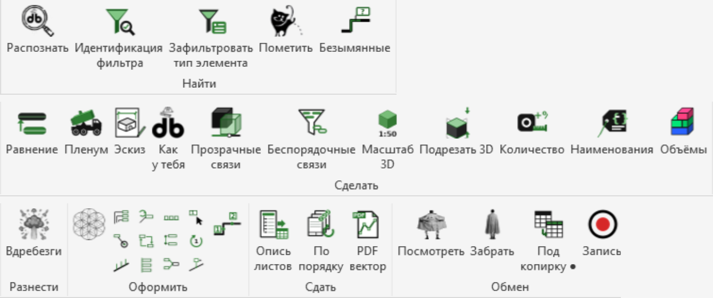

<div align="center">

<picture>
  <source media="(prefers-color-scheme: dark)" srcset="docs/img/logo_dark.png">
  
</picture>

# XYZ — pyRevit extension for MEP designers

[Русский](README.md) · **English**

[](https://github.com/Budzhak/XYZ/releases)
[](LICENSE)
[](#compatibility)
[](#compatibility)
[](https://t.me/xyz_for_revit)

So that Revit routine doesn't spoil your mood, use XYZ.

MEP tools for Revit: tags, schematics, plenum families, fabrication sketches, quantities and naming, schedules and sheet export. English and Russian UI.

</div>



## Contents

- [Features](#features)
- [Compatibility](#compatibility)
- [Installation](#installation)
- [Updating](#updating)
- [Buttons](#buttons)
- [General rules](#general-rules)
- [What's new](#whats-new)
- [Troubleshooting](#troubleshooting)
- [License](#license)
- [Feedback](#feedback)

## Features

XYZ adds its own **XYZ** tab to the Revit ribbon with six panels:

| Panel | Purpose |
|---|---|
| **Inspect** | find and select: what is selected, which filter, untagged runs |
| **Model** | routing alignment, plenums, sketches, links, quantities, naming, volumes |
| **Explode** | exploded views by connections |
| **Annotate** | tags and leaders, numbering, refrigerant runs |
| **Publish** | sheet contents and numbering, vector PDF |
| **Exchange** | schedules ⇄ Excel, schedule formatting, screen recording |

Hover over a button to see its tooltip. Button titles and tooltips are available in English and Russian; pyRevit shows them in its own UI language. Command windows and the detailed button docs (`docs/Кнопки`) are in Russian for now.

## Compatibility

| | Tested on |
|---|---|
| Revit | **2025.4** |
| pyRevit | **6.1.0**, **7.0.0** (7.0.0.26278) |
| UI language | English, Russian (follows pyRevit) |
| Templates | ADSK shared parameters, our own `db_*` parameters |

> [!IMPORTANT]
> Other Revit and pyRevit versions have not been tested.

> [!WARNING]
> The tools were written for specific projects and templates (ADSK shared parameters and our own `db_*` parameters). Before bulk changes — do a trial run and save the model.

## Installation

### 1. pyRevit 6.1.0 or 7.0.0

Close Revit, download and run the installer (pyRevit 7 — see [pyRevit releases](https://github.com/pyrevitlabs/pyRevit/releases)):
- [pyRevit_6.1.0.26047_signed.exe](https://github.com/pyrevitlabs/pyRevit/releases/download/v6.1.0.26047%2B2255/pyRevit_6.1.0.26047_signed.exe) — regular per-user install;
- all files of this version — on the [6.1.0 release page](https://github.com/pyrevitlabs/pyRevit/releases/tag/v6.1.0.26047%2B2255).

Start Revit — the **pyRevit** tab appears on the ribbon.

### 2. XYZ — from the Git URL

1. Close Revit.
2. Press **Win + R**, type `cmd`, press Enter.
3. Run:
   ```
   pyrevit extend ui XYZ https://github.com/Budzhak/XYZ.git
   ```
4. Start Revit — the **XYZ** tab appears.

> [!NOTE]
> XYZ will be listed in pyRevit's extension catalogue (pyRevit → **Extensions**) starting with **pyRevit 7.1** — then it can be installed from there with one **Install Extension** click. Until then, use the Git URL as above.

> [!NOTE]
> If you installed XYZ manually before, close Revit and delete the old folder `%APPDATA%\pyRevit\Extensions\XYZ.extension` first.

**Fallback — manually:** download the [v1.0 release](https://github.com/Budzhak/XYZ/releases/tag/v1.0) archive or, at the top of this page, **Code → Download ZIP**; unpack it into `%APPDATA%\pyRevit\Extensions\`, rename the folder (`XYZ-main` or `XYZ-1.0`) to `XYZ.extension`, then pyRevit → **Reload**.

### 3. Tab position

The **XYZ** tab appears at the end of the ribbon. To place it right after **Insert**, set `"tab_after_insert": true` in `%APPDATA%\pyRevit\xyz_settings.json` and Reload.

### 4. Vector PDF (optional)

PDF optimisation runs in a separate Python 3 ([python.org](https://www.python.org/downloads/windows/)) with:
```
py -m pip install --user pikepdf shapely numpy
```
Without them, sheets are exported by Revit as is, without optimisation.

## Updating

pyRevit → **Update** — pyRevit downloads new versions of installed extensions (including XYZ) and reloads itself. If you installed manually, download the ZIP again and replace the folder, then Reload.

Changes are listed in [Releases](https://github.com/Budzhak/XYZ/releases) and in [What's new](#whats-new).

## Buttons

Links lead to the detailed docs (in Russian), **▶** — to a short animation.

### Inspect

| | Button | What it does | |
|:-:|---|---|:-:|
|  | [Identify](docs/Кнопки/Распознать.md) | lists the selection grouped by type, with previews | [▶](docs/img/gif/Распознать.gif) |
|  | [Which Filter](docs/Кнопки/Идентификация%20фильтра.md) | which view filters (including link filters) affect the selected element and their rules; switch a filter off from the window | [▶](docs/img/gif/Идентификация%20фильтра.gif) |
|  | [Filter by Type](docs/Кнопки/Зафильтровать%20тип%20элемента.md) | a visibility filter for the type of the selected element, applied to the active view | |
|  | [Mark](docs/Кнопки/Пометить.md) | writes a mark into a parameter and creates a schedule filtered by it | [▶](docs/img/gif/Пометить.gif) |
|  | [Untagged Runs](docs/Кнопки/Безымянные.md) | pipe runs without a tag on the view; «Show» selects and zooms to the whole run, «◀ / ▶» — next one | |

### Model

| | Button | What it does | |
|:-:|---|---|:-:|
|  | [MEP Align](docs/Кнопки/Равнение.md) | pipes, ducts, cable trays: onto the reference axis, to its elevation, plumb risers | |
|  | [Plenum](docs/Кнопки/Пленум.md) | plenum box family with branch connections | [▶](docs/img/gif/Пленум.gif) |
|  | [Fabrication Sketch](docs/Кнопки/Эскиз.md) | a fabrication sketch of a family in a legend view: views, axonometry, Revit dimensions, openings, notes | [▶](docs/img/gif/Эскиз.gif) |
|  | [Replace by Sample](docs/Кнопки/Как%20у%20тебя.md) | replaces an element with the type of a sample element | |
|  | [Link Transparency](docs/Кнопки/Прозрачные%20связи.md) | transparency slider for linked models (via view filters) | [▶](docs/img/gif/Прозрачные%20связи.gif) |
|  | [Link Parameters](docs/Кнопки/Беспорядочные%20связи.md) | adds IFC/RVT link parameters to the project so view filters can use them | [▶](docs/img/gif/Беспорядочные%20связи.gif) |
|  | [3D Scale](docs/Кнопки/Масштаб%203D.md) | writes «( 1 : N)» into 3D view titles on sheets | [▶](docs/img/gif/Масштаб%203D.gif) |
|  | [Crop 3D](docs/Кнопки/Подрезать%203D.md) | top and bottom of a 3D section box by levels with offsets, like a view range | [▶](docs/img/gif/Подрезать%203D.gif) |
|  | [Quantities](docs/Кнопки/Количество.md) | quantities with allowances by rules (category + condition → how to count → allowance), with a before/after preview | |
|  | [Naming](docs/Кнопки/Наименования.md) | fills name, section and sort-key parameters from rule templates, with a before/after preview | [▶](docs/img/gif/Наименования.gif) |
|  | [Space Volumes](docs/Кнопки/Объёмы.md) | masses from MEP spaces, view colouring by a parameter, legends with totals | [▶](docs/img/gif/Объёмы.gif) |

### Explode

| | Button | What it does | |
|:-:|---|---|:-:|
|  | [Exploded View](docs/Кнопки/Вдребезги.md) | exploded view of the selection by its connections | [▶](docs/img/gif/Вдребезги.gif) |

### Annotate

| | Button | What it does | |
|:-:|---|---|:-:|
|  | [Tag Tools](docs/Кнопки/По%20красоте.md) | tag alignment, tag columns, tag reset, elevation marks on exploded views; experimental modes ask for confirmation | |
| | 11 small buttons | Column, Center Leader, Even Spacing, Reset Tags, Reverse, Align Vertical, Align Horizontal, Measure Spacing, Merge Tags, Click Numbering, Clockwise Numbering — Tag Tools commands without the menu; also on the «Modify \| …» tab | |
|  | [Straight Leader](docs/Кнопки/Прямая%20выноска.md) | click a tag, then where it should go — the leader becomes straight and slides along the pipe | [▶](docs/img/gif/Прямая%20выноска.gif) |
|  | [Refrigerant Runs](docs/Кнопки/Участки%20фреона.md) | refrigerant liquid-line segments on a 3D scheme: number, size, elbows, height difference, length; a schedule per system | [▶](docs/img/gif/Участки%20фреона.gif) |

### Publish

| | Button | What it does | |
|:-:|---|---|:-:|
|  | [Sheet Contents](docs/Кнопки/Опись%20листов.md) | sheet contents → Excel | [▶](docs/img/gif/Опись%20листов.gif) |
|  | [Renumber Sheets](docs/Кнопки/По%20порядку.md) | sheet numbers in order within Project Browser groups, with a preview | [▶](docs/img/gif/По%20порядку.gif) |
|  | [Vector PDF](docs/Кнопки/PDF%20вектор.md) | sheets to lightweight vector PDF (raster sheets skipped, optimised) | [▶](docs/img/gif/PDF%20вектор.gif) |

### Exchange

| | Button | What it does | |
|:-:|---|---|:-:|
|  | [Schedule to Excel](docs/Кнопки/Посмотреть.md) | schedule → Excel | [▶](docs/img/gif/Посмотреть.gif) |
|  | [Excel to Schedule](docs/Кнопки/Забрать.md) | Excel → Revit | |
|  | [Copy Format](docs/Кнопки/Под%20копирку.md) | schedule formatting → other schedules with the same columns; Shift+click — column widths only | |
|  | [Screen Recorder](docs/Кнопки/Запись.md) | launches [XYZ Record](https://github.com/Budzhak/XYZ-Record) (screen + voice) from Revit; downloads it from GitHub if missing; Shift+click — program folder | |

## General rules

- **XYZ panel on the «Modify | …» tab:** when something is selected, Identify, Which Filter, Filter by Type, Tag Tools and MEP Align are also available on Revit's contextual tab.
- **Every command:** where (selection / view / model) → what (options) → before/after preview → Apply / Cancel → report. One command = one transaction, undo with **Ctrl+Z**.
- View graphics are changed with **view filters** only, never with per-element overrides.
- No network access, no bundled binaries. The model-change updater for elevation marks is off by default (`elev_marks_auto` in `xyz_settings.json`).

## What's new

| Date | What |
|---|---|
| Nov 2026 | [Screen Recorder](docs/Кнопки/Запись.md) button (Exchange panel); pyRevit 7.0.0 support |
| 28 Oct 2026 | new button [Fabrication Sketch](docs/Кнопки/Эскиз.md) |
| 21 Oct 2026 | new buttons [Quantities](docs/Кнопки/Количество.md), [Naming](docs/Кнопки/Наименования.md), [Space Volumes](docs/Кнопки/Объёмы.md); common command workflow |
| 20 Oct 2026 | [Schedule to Excel](docs/Кнопки/Посмотреть.md) — version 3 |

All versions are on the [Releases](https://github.com/Budzhak/XYZ/releases) page; the first one is [v1.0](https://github.com/Budzhak/XYZ/releases/tag/v1.0).

## Troubleshooting

- The tab doesn't appear or buttons fail: close Revit, delete `%APPDATA%\pyRevit\Extensions\XYZ.extension` and install XYZ again as described in [Installation](#installation).
- Settings live in `%APPDATA%\pyRevit\xyz_settings.json`; deleting it resets the extension to its defaults.
- Vector PDF exports without optimisation — check that Python 3 and the libraries are installed (installation step 4).

## License

[GPL-3.0](LICENSE). Some windows are based on [pyRevit](https://github.com/pyrevitlabs/pyRevit) forms (GPL-3.0).

Thanks to [Ehsan Iran-Nejad](https://github.com/eirannejad) and the [pyRevit](https://github.com/pyrevitlabs/pyRevit) team for the platform.

## Feedback

Questions, bugs and ideas — in the comments under posts in the Telegram channel [@xyz_for_revit](https://t.me/xyz_for_revit) (news, tips and button demos) or in [Issues](https://github.com/Budzhak/XYZ/issues).

> [!TIP]
> When reporting a bug, please attach a screenshot and state your Revit (and pyRevit) version.

Author — [Dmitry Budzhak](https://github.com/Budzhak).
