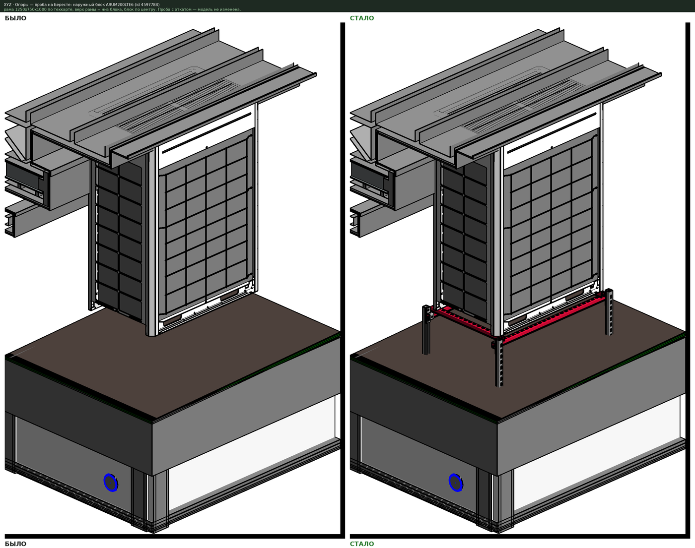

# Опоры

↩ [XYZ](../../README.md)

> [!NOTE]
> **Версия 0.1 — первая, черновая.** Рамы под оборудование проверены пробой с откатом. Опоры трасс (воздуховоды, трубы, лотки) считаются и показываются в пробе, но расстановка на трассах на живой модели ещё не проверялась — в проекте не было ни семейств, ни техкарты для них.

## Что делает
Ставит опорные конструкции под оборудование (наружные блоки, вентустановки, вентиляторы на кровле и площадках) и вдоль трасс (воздуховоды, трубы, лотки). Что именно ставить, какого размера, с каким шагом — кнопка берёт **только из техкарты производителя**: это внешний файл правил, который проектировщик открывает и правит сам. В коде кнопки нет ни одного производителя и ни одного семейства.

## Демонстрация

Наружный блок без опоры → по техкарте подобрана рама 1250х750х1000, верх рамы встал на низ блока, блок по центру. На картинке видно и то, о чём кнопка предупреждает в пробе: до кровли под блоком 407 мм, а рама по техкарте высотой 1000 — высоту надо задать свою (поле «Высота комплекта H»).

## Когда применять
- Оборудование расставлено, а рам и опор под ним ещё нет.
- Трассы проложены, нужны опоры или подвесы с шагом по техкарте.
- Сменился производитель опор: меняется файл техкарты, кнопка та же.

## Как пользоваться
1. Выделите оборудование и (или) прямые участки трасс. Если ничего не выделено, кнопка попросит выбрать.
2. Нажмите «Опоры». Вверху окна — «Техкарта производителя»: название, файл и откуда взяты правила.
   - «Открыть…» — другой файл техкарты; выбор запоминается для этой модели.
   - «Править в Блокноте» → поправить → «Перечитать».
   - «Сохранить как…» — копия под своего производителя; «Шаблон» — пустая техкарта с образцами записи; «Стандартная» — та, что идёт с плагином.
3. Вкладка «Проба: что станет» — по строке на объект: габарит, масса, подобранный комплект и типоразмер, сколько штук, отметка верха опоры, расстояние до основания (если нашлось), статус и примечание. Вкладка «Итог» — сколько каких типоразмеров и какие типы будут созданы.
4. «Показать в модели» (или двойной щелчок по строке) — выделяет объекты в Revit.
5. «Высота комплекта H, мм» — своя высота вместо высоты по техкарте (пусто — по техкарте).
6. «В Excel» — текущая вкладка в таблицу.
7. «Применить» — ставит семейства. До этого модель не меняется.

Статусы: «поставить», «уже стоит» (под объектом найдена опора из техкарты — второй раз не ставится), «нет правила» (в техкарте нет комплекта под такой объект), «не выходит» (размер вне ряда техкарты, семейство не загружено — причина в примечании).

## Техкарта
Файл JSON. Стандартный лежит в папке плагина `Техкарты`; свой можно держать где угодно.

Раздел `комплекты` — список правил, выбирается **первое подходящее сверху вниз**:

| Поле | Что значит |
|---|---|
| `для` | `оборудование` или `трасса` |
| `условия` | когда правило подходит: `категории`, `семейство_содержит`, `семейство_не_содержит`, `масса_до_кг`, `длина_до_мм`, `ширина_до_мм`, `размер_от_мм` / `размер_до_мм` (трассы) |
| `семейство`, `файл_семейства` | какое семейство ставить; файл — если его надо загрузить |
| `тип_имя`, `образец_типа` | имя типоразмера по шаблону, например `{L}х{W}х{H}`; нет такого типа — создаётся копией образца |
| `размеры` | как получить размеры комплекта: число, формула или правило `{"от": "l", "округление": "вверх", "шаг_мм": 250}` либо с рядом `"ряд_мм": [500, 750, 1000]`, пределы `мин_мм`, `макс_мм` |
| `параметры_типа`, `параметры_экземпляра` | какие параметры семейства заполнить и чем (число, формула или `{"текст": "..."}`) |
| `как_у_объекта` | параметры, которые копируются с объекта (например, номер здания) |
| `шаг_мм`, `отступ_от_концов_мм`, `не_меньше_шт`, `поворот` | для трасс: наибольший шаг опор, отступ крайних от концов участка, поперёк или вдоль |
| `совмещение` | как посадить: `в_плане` — «центр габарита» или «точка вставки»; `по_высоте` — «верх габарита» (верх опоры к низу объекта), «низ габарита» или «точка вставки»; `сдвиг_мм` |
| `состав` | что входит в комплект — для примечания в пробе |
| `пример` | `true` — правило-образец, не работает |

В формулах: `l`, `w`, `h` — длина, ширина, высота объекта, мм (`l` — длинная сторона в плане); `m` — масса, кг; `база` — расстояние до перекрытия или кровли под объектом; `D` — диаметр, `B`, `A` — сечение, `s` — наибольший размер сечения, `len` — длина участка; `L`, `W`, `H` — уже подобранные размеры. Действия `+ - * /`, скобки, функции `вверх(x; шаг)`, `вниз(x; шаг)`, `ближайшее(x; шаг)`, `макс(...)`, `мин(...)`. Десятичный знак — точка.

Шаг опор на трассе: крайние — на отступе от концов, между ними поровну, так чтобы фактический шаг был не больше шага по техкарте.

> [!IMPORTANT]
> **Стандартная техкарта — не каталог производителя.** Она выведена из того, как рамы уже стоят в рабочей модели: длина рамы — габарит блока вверх до 250 мм, ширина — ближайшая с шагом 250, высота 1000, четыре опоры. Пределов по массе в ней нет. Прежде чем ставить по ней массово, сверьте с каталогом производителя и впишите его числа.

## Что меняется в модели
- Появляются экземпляры семейств из техкарты; при необходимости — новый типоразмер (копия образца с размерами по техкарте).
- Новые элементы попадают в рабочий набор объекта, под который ставятся.
- Одна транзакция «Опоры: поставить по техкарте» — отмена Ctrl+Z.
- Выбранный файл техкарты и размер окна запоминаются (`xyz_settings`, ключи `opory`, `win_opory`).

## Ограничения
- Оборудование — семейства, стоящие вертикально. Группа блоков на общей раме не собирается: каждый объект получает свой комплект; объект длиннее предела техкарты — «нет правила».
- Трассы — только прямые горизонтальные и наклонные участки; вертикальные пропускаются.
- Расстояние до основания ищется лучом вниз в активном 3D-виде (или в виде «{3D}») по перекрытиям и крышам, в том числе в связях. Если связь на виде скрыта — расстояние не найдётся, графа будет пустой.
- Масса берётся из параметра, названного в техкарте (`параметры_массы`). Не заполнена — условие по массе не проверяется, об этом сказано в примечании.
- Пересечения опор с другими элементами не проверяются.

## Отмена
Ctrl+Z в Revit сразу после «Применить».

## Техническое (для Claude)
- `script.py` — окно `OporyWindow` (WPF, стандарт окон «Объёмов»: `forms.adaptive`, `@guarded`), таблицы `DataTable`.
- `lib/xyz_opory.py`: `calc` (разбор формул без `eval`), `pick_size`, `spots` — чистый расчёт без Revit; `load_card` / `save_card` / `check_card`; `probe(doc, elements, card, view3d, overrides)` — только чтение; `apply(doc, rows, card)` — внутри транзакции; `footprint`, `base_distance`, `totals`.
- Посадка: экземпляр создаётся в точке, поворачивается вокруг вертикали по длинной стороне объекта, затем сдвигается по фактическому габариту (центр → центр, верх → низ объекта) — поэтому точка вставки семейства может быть где угодно.
- Проба 14.11.2026 (в группе транзакций с откатом): блок 1242х774 → рама 1250х750х1000, верх рамы − низ блока = 0,0 мм, свес рамы за блок 294/294 и 268/268 мм — как у рамы, уже стоящей в модели под таким же блоком; второй блок 1646х777 → создан тип 1750х750х1000. После отката модель без изменений.
