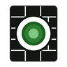

# Отверстия

↩ [XYZ](../../README.md)

## Что делает
Готовит **задание на отверстия**: находит, где ваши сети — воздуховоды, гибкие воздуховоды, трубы и кабельные лотки — проходят сквозь стены, перекрытия и крыши из связанных моделей (IFC и RVT). Для каждого места показывает конструкцию и её толщину, этаж, размер сети, размер отверстия с запасом, отметки и координаты. Близкие отверстия в одной конструкции объединяет в одно.

В модели ничего не создаётся и не меняется — кнопка только ищет и показывает.

## Демонстрация
_GIF будет добавлен._

## Когда применять
- Перед выдачей задания архитекторам и конструкторам: список отверстий с размерами и отметками.
- После переноса трасс — быстро проверить, где появились новые проходки.
- На активном виде — чтобы увидеть проходки одного этажа или одной системы.

## Как пользоваться
1. Откройте вид с сетями. Связь с архитектурой должна быть загружена.
2. Нажмите **Отверстия** на панели «Найти».
3. В окне «Отверстия» выберите, **где искать**: выделенное, активный вид или вся модель.
4. Отметьте сети, виды конструкций и связи. Поправьте запасы, если нужно.
5. Нажмите **Найти**. Появится таблица, под ней — итог: сколько отверстий, по этажам, время.
6. Щелчок по строке — выделить сети этой проходки. Двойной щелчок — показать их на виде. Щелчок по заголовку столбца — сортировка.
7. **В Excel** — вся таблица в файл (CSV, открывается в Excel).
8. **Выделить на виде** — выделить сети отмеченных строк (если ничего не отмечено — всех строк) и закрыть окно.

## Режимы и настройки
| Настройка | По умолчанию | Что значит |
|---|---|---|
| Круглое: D + | 100 мм | Диаметр отверстия для круглой сети |
| Прямоугольное: + | 50 мм | Запас с каждой стороны для прямоугольной сети |
| Округлять вверх до | 10 мм | Размер отверстия округляется вверх; 0 — не округлять |
| Размер сети — с изоляцией | включено | К размеру сети добавляется толщина изоляции |
| Объединять ближе | 100 мм | Отверстия в одной конструкции с просветом меньше этого сливаются в одно прямоугольное; так же склеиваются слои одной стены |
| Вдоль: в теле больше | 1000 мм | Сеть, которая идёт внутри конструкции дольше этого, — не отверстие (труба в стяжке, стояк в стене) |
| Сети мельче | 0 мм | Не показывать мелкие сети |
| Не показывать сети вдоль конструкций | включено | Снять — такие строки появятся с пометкой в «Примечании» |

Настройки запоминаются. Окно тянется, Ctrl+колесо — масштаб, Ctrl+0 — 100 %.

### Столбцы таблицы
№ · Этаж · Конструкция (стена, перекрытие, крыша) · Имя конструкции (IfcName или тип) · Материал · Толщина · Сеть · Система · Размер сети · Изоляция · Отверстие · Ширина · Высота · Отметка центра · Отметка низа · Низ от уровня · X · Y · Сетей · Id сетей · Id конструкции · Этаж АР · Связь · Примечание.

- **Этаж** — уровень вашей модели не выше отверстия. Для стены берётся отметка центра, для перекрытия — верх плиты.
- **Отметки** — от нуля модели, в мм. У перекрытия «низ» — низ плиты.
- **Примечание**: «объединено: N», «слоёв: N», «сеть заканчивается в конструкции» (решётка или клапан в стене), «под углом N° к нормали».

## Что меняется в модели
Ничего. Меняется только выделение и масштаб вида.

## Ограничения и подводные камни
- Проверяется **ось** сети. Сеть, которая задевает конструкцию только краем, не попадёт в список.
- Соединительные детали, арматура и оборудование не проверяются — только прямые участки и гибкие воздуховоды.
- Конструкции берутся только из **загруженных** связей. Число незагруженных показано в окне.
- Конструкции IFC, у которых вместо тела сетка, не проверяются — их число есть в итоге.
- Подвесные потолки и отделка в IFC часто лежат в категории «Перекрытия» или «Стены» — такие строки видно по столбцам «Имя конструкции» и «Материал».
- При наклонном проходе размер отверстия не увеличивается на косину — см. «Примечание».
- Объединённое отверстие всегда прямоугольное.
- Окно модальное: пока оно открыто, работать в Revit нельзя.

## Отмена
Нечего отменять — модель не меняется.

## Техническое (для Claude)
- `lib/xyz_holes.py`: `links(doc)`, `find(doc, uidoc, opt)` → `(rows, stats)`, `summary(stats)`, `to_csv(rows, path)`, `COLUMNS`, `DEFAULTS`.
- Поиск: габариты конструкций связи в сетке 10 футов → отсев по габариту (Лян — Барски) → `Solid.IntersectWithCurve(ось, CurveSegmentsInside)`. Тела кэшируются по мере надобности. Нормаль грани входа — `Face.Project` + `ComputeNormal`; на ребре берётся грань, нормаль которой ближе к оси.
- «Вдоль»: длина в теле больше предела; вертикальная ось в стене; вход через торец плиты; угол оси к нормали больше 60°.
- Объединение: объединение множеств по конструкциям, просвет между прямоугольниками отверстий в плоскости конструкции.
- Настройки — `xyz_settings`, ключ `holes`; окно — `win_holes`.
- 13.11.2026, v0.1.0. Проба на рабочей модели ОВ (5754 сети × 5497 конструкций IFC): 496 отверстий, поиск 1,2 с.

> [!TIP]
> Демонстрация и обсуждение — в Telegram-канале [@xyz_for_revit](https://t.me/xyz_for_revit).
