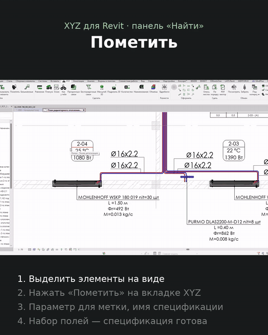

# Пометить

↩ [XYZ](../../README.md)

> [!NOTE]
> **Что делает**
> Делает спецификацию ровно по выделенным элементам. Выделенным элементам записывается в выбранный параметр одинаковая уникальная метка, затем создаётся новая спецификация «<Несколько категорий>» (или копия существующей) с фильтром по этой метке.

## Демонстрация

## Когда применять
Нужна быстрая ведомость произвольной выборки (узел, участок, «вот эти 15 штук»), которую не выделить ни системой, ни категорией.

## Как пользоваться
1. Выделите минимум 2 элемента.
2. Нажмите «Пометить».
3. «Выберите параметр для записи уникальной метки» — список записываемых параметров экземпляра, общих для всех выделенных, плюс «Комментарии (запасной вариант)».
4. Метка сразу записывается во все элементы.
5. «Что делаем со спецификацией?»: «Клонировать существующую спеку» или «Создать новую спеку».
6. «Имя новой спецификации» (по умолчанию «Обосанные»).
7. **Клонировать:** выбрать образец среди спецификаций «<Несколько категорий>» → «Клонировать». Копия получит скрытое поле метки и фильтр по нему.
8. **Создать новую:** окно «Выберите набор полей»:
   - сохранённый набор → «Просмотреть» → показ состава → «Да», чтобы использовать;
   - «+ Выбрать поля вручную (новый набор)» → отметить поля → окно «Порядок столбцов» (кнопки «Вверх/Вниз», «Готово»);
   - «⚙ Управлять наборами» → удалить набор или изменить его состав.
9. Откроется новая спецификация. Если поля выбирались вручную, будет предложено сохранить набор под именем.

## Режимы и настройки
Наборы полей хранятся в настройках pyRevit (`field_presets`) на этом компьютере.

## Что меняется в модели
- В выбранный параметр всех выделенных элементов записывается метка: текст `MARK-<время>-<случайное число>`, а для числового параметра — число.
- Создаётся спецификация с фильтром «параметр = метка». Поле метки скрыто.

## Ограничения и подводные камни
- **Старое значение параметра затирается.** Выбирайте пустой служебный текстовый параметр или «Комментарии». Ни в коем случае не числовой параметр, от которого зависит геометрия (смещение, длина и т. п.): элементы изменятся.
- Метка записывается до выбора режима спецификации. Если потом нажать «Отмена», метка в элементах останется.
- Клонировать можно только спецификации «<Несколько категорий>». Фильтры образца сохраняются и действуют вместе с новым — часть элементов может не попасть в копию.
- Если параметр метки нельзя вывести в спецификацию этой категории, будет ошибка, и спецификация не создастся.
- Повторный запуск по тем же элементам перезапишет метку, и старая спецификация «опустеет».

## Отмена
Две отдельные транзакции — «Запись метки для группировки» и «Клонирование/Создание спецификации». Чтобы отменить всё, нажмите Ctrl+Z дважды.

## Техническое (для Claude)
- `script.py`: общие параметры экземпляра через `p.Id.IntegerValue`; `resolve_param` (отрицательный id — BuiltInParameter, положительный — ParameterElement).
- `ViewSchedule.CreateSchedule(doc, InvalidElementId)` или `Duplicate`; `ensure_field_and_get_field_id(..., hide_if_new=True)`; `ScheduleFilter(Equal)`.
- Окно порядка — `forms.reorder_list` из `xyz_forms`.

> [!TIP]
> Демонстрация и обсуждение — в Telegram-канале [@xyz_for_revit](https://t.me/xyz_for_revit).
